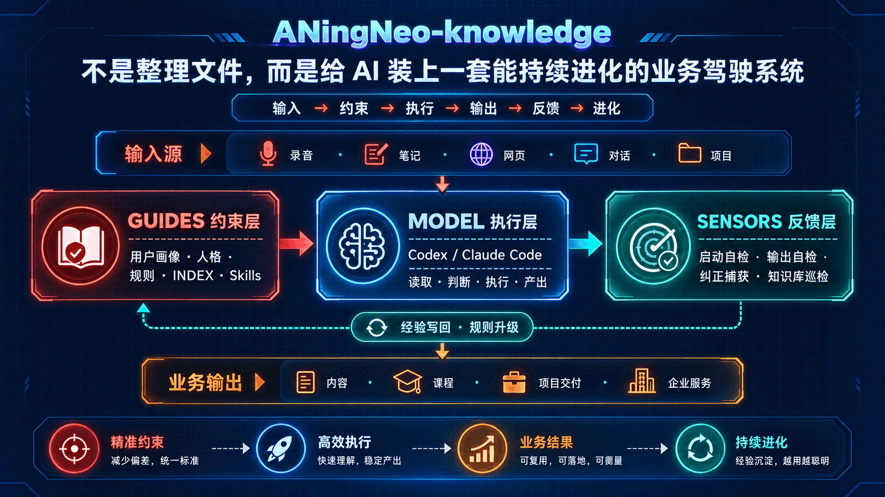

# ANingNeo Skills

**给 AI Agent 用的工作手册合集。** 装进 WorkBuddy、Codex、Claude Code 这类 Agent 后，它就知道一件活该先问什么、按什么顺序做、做到哪一步要停下来等你点头、最后交出什么。

[⬇ 下载最新版](https://github.com/8533502-dev/ANingNeo-skills/releases/latest) ｜ [📂 打开 skills 目录](skills/)

---

## 三十秒找到你要的

**你在做短视频 / 图文账号？**
→ 用 [调研](#调研对标账号和评论) 摸清对标账号，用 [拆解](#拆一条爆款视频) 学透单条爆款，再用 [知识库](#把资料变成-ai-的工作台) 把定位、选题、素材和复盘串起来。

**你在一家公司，资料散落各处？**
→ 用 [知识库的企业模式](#公司版产品客户sop-三个库) 把产品、客户、流程分别归位。旅行社、研学机构、营地已有现成的行业分类。

**你开了一家店？**
→ 用 [门店物料](#门店物料) 出菜品图、菜单和活动海报。

| 能力包 | 一句话 | 版本 |
| --- | --- | --- |
| [`aningneo-research`](skills/aningneo-research/) | 批量抓各平台的公开账号、作品和评论 | v0.8.0 |
| [`aningneo-viral-breakdown`](skills/aningneo-viral-breakdown/) | 一条视频，从开头拆到评论区 | v1.0.0 |
| [`aningneo-knowledge`](skills/aningneo-knowledge/) | 个人 / 自媒体 / 公司知识库，含企业模式 | v0.5.0 |
| [`aningneo-local-store`](skills/aningneo-local-store/) | 实体门店的图片和推广物料 | v0.1.1 |

每个能力包都能单独装。用 [Skills CLI](https://www.npmjs.com/package/skills) 安装时，只需把最后的名字换掉：

```bash
npx -y skills@latest add 8533502-dev/ANingNeo-skills --skill aningneo-research -y
```

不用命令行的话，去 [Releases](https://github.com/8533502-dev/ANingNeo-skills/releases/latest) 下载对应的 ZIP，解压后把文件夹放进 Agent 的 Skill 目录即可。

---

## 调研对标账号和评论

`aningneo-research`

你给出账号、链接、关键词，或一份现成的表格，它负责把数据拉下来并整理成表。抖音、小红书、视频号、快手、B站、微博、知乎，以及 TikTok、YouTube、Instagram、X、Reddit 都在范围内。

能拿到的东西：主页资料、作品列表、单条详情、评论、字幕、点赞收藏等公开数据、搜索结果。
最后交给你的：结构化表格、评论洞察、逐字稿、选题建议，敏感字段已脱敏。

**它不会一上来就猛抓。** 顺序永远是：

1. 找到对应接口，算出这次要发多少请求、大概花多少钱；
2. 先抓 1–3 条给你看字段对不对；
3. 你确认后才批量。

试着这样说：

```text
用 aningneo-research 看看这个小红书号最近 100 条笔记，每条带一页评论。先报价，再抽 3 条样本。
```

```text
我这有一份导出的抖音数据 Excel，用 aningneo-research 帮我去重清洗，再总结评论区大家最关心什么。原表别动。
```

### 关于钱

> Skill 本身不收费；抓数据用的 TikHub 接口按次计费，由你直接付给 TikHub。

- 账号和 Key 需要你自己去 [TikHub](https://tikhub.io/getting-started) 注册、充值、创建。本项目跟 TikHub 没有合作关系，也不经手转售，接口出问题请找 TikHub。
- 价格量级：大多数接口单次 0.001–0.01 美元，少数特殊接口更贵。新注册约送 0.05 美元，够试几十次。以 [官方价格页](https://tikhub.io/pricing) 为准。
- 抓 100 条大约 0.1–1 美元，抓 1000 条大约 1–10 美元。翻多少页评论、要不要逐条详情、是否转写语音，都会让数字上下浮动，所以每次都以开跑前的报价为准。

### 关于 Key

只需设置一次：

```bash
python3 .agents/skills/aningneo-research/scripts/tikhub_request.py --configure-local-key
python3 .agents/skills/aningneo-research/scripts/tikhub_request.py --check-config
```

Key 会写进 Skill 目录里的 `scripts/.tikhub_api_key`，之后关掉会话、换终端都还在；这份文件比环境变量优先。不想放这里，也可以用别的路径、`config.json`、环境变量或 macOS 钥匙串。直接把 Key 发给 Agent 也行，它会替你存好。

仓库和下载包里不带任何 Key。换电脑或重装系统时，记得自己备份这份文件。

参考：[配置说明](skills/aningneo-research/references/configuration.md) · [付费接口说明](skills/aningneo-research/references/paid-api-route.md)

---

## 拆一条爆款视频

`aningneo-viral-breakdown`

丢一个链接或视频文件给它，交回一份拆解报告，回答下面这些问题：

- 观众为什么愿意看完？价值点在哪？
- 前几秒怎么留人，后面每一段怎么推进？
- 评论区在夸什么、问什么、吵什么？
- 分镜是怎么安排的？

报告附带带时间戳的完整逐字稿，最后落到"换成你的账号该怎么用"。

已有文稿、字幕或截图？直接给它，不需要 API。只有一个链接？它会调用上面的调研 Skill 去取素材，照样先报价。素材缺哪块就跳过哪块，不会凭空补画面或评论。

```text
用 aningneo-viral-breakdown 复盘我上周这条视频：[链接]，重点看为什么前 3 秒流失大。
```

[更多说明](skills/aningneo-viral-breakdown/README.md)

---

## 把资料变成 AI 的工作台

`aningneo-knowledge`



很多人的"知识库"其实是一个越来越大的文件夹。这个 Skill 想做的是另一件事：让 AI 每次开工前都能读到你是谁、最近在忙什么、哪些规矩不能破、哪些资料可信；做完之后能自查，被你纠正后把教训写回去，下次不再犯。

它能帮你：新建知识库、接入已有文件、体检（断链、重复、缺索引、敏感信息）、按建议修复、记录纠错。

### 自媒体版

选 `creator` 模式，会搭出一条从账号定位到发布复盘的链路：定位 → 对标 → 用户洞察 → 素材 → 选题 → 草稿 → 定稿 → 发布 → 复盘。

```text
用 aningneo-knowledge 的 creator 模式，在这个文件夹里给我的账号建知识库。先看看我已经有什么，别直接写。
```

### 公司版：产品、客户、SOP 三个库

选 `enterprise` 模式：

| 库 | 装什么 |
| --- | --- |
| 产品库 | 能卖的东西：线路、酒店、景点、报价、推文 |
| 客户库 | 跟谁做生意：名单、档案、导出的聊天 |
| 技能库 | 怎么做事：SOP、清单、模板 |

Agent 会先问清公司业务和资料位置，原文件一个不挪，只在三库里建索引指过去。结束时告诉你每个库收进了什么、还缺什么。

文旅类机构可以直接用预置的 24 个细分目录（研发、采购、团期、交易、复盘等），按需打开。模板里也写好了报价、宣传、投标、分房分车、售后等常见任务该怎么接、怎么查、断了怎么续。

[企业模式完整说明](skills/aningneo-knowledge/references/enterprise-mode.md) · [安装提示词](skills/aningneo-knowledge/README.md)

用 Claude Code 的话，可以按需启用 `assets/optional/claude-code/CLAUDE.md`。

---

## 门店物料

`aningneo-local-store`

菜品图、菜单价目表、活动海报、门头预览、小红书 / 抖音 / 朋友圈图文。先对齐菜名、价格、活动这些硬信息再出图，避免为了好看写错价格。图片接口由你自己选、自己配、自己付费；它不会自动发帖，也不会动外卖后台。

[使用说明](skills/aningneo-local-store/README.md)

---

## 这些 Skill 共同遵守的规矩

- 先给方案，你说可以再动手：写文件前先预览，花钱前先报价。
- 你的原始文件只读不改，产出另存。
- 分清"原文写的""别人说的""你认为的""AI 总结的"。
- 用了第三方服务就明说，不包装成自己的能力。
- 只收录真实工作中反复出现的场景，每个都配有测试。
- 这个仓库只放通用能力；具体项目的素材、录屏、客户资料各自单独存放。

## 其他

维护：ANingNeo · [@8533502-dev](https://github.com/8533502-dev)
更新记录见 [CHANGELOG](CHANGELOG.md)，下载包见 [Releases](https://github.com/8533502-dev/ANingNeo-skills/releases)。
许可：[MIT](LICENSE)
